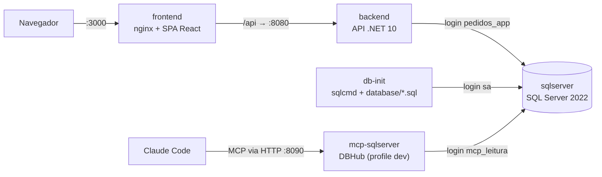

# Pedidos de Clientes

[](https://github.com/ppBernardo/pedidos-clientes/actions/workflows/ci.yml)

Cadastro e consulta de pedidos: **SQL Server 2022 + API .NET 10 + React 19**, tudo subindo com um único `docker compose up`. O projeto foi feito com **Claude Code** em fluxo spec-driven (SDD), e a configuração do Claude está versionada no repositório: rules, hooks, skills, subagente e MCP.

| Documento | Conteúdo |
|---|---|
| [docs/spec.md](docs/spec.md) | Especificação: regras (RN), contrato da API, critérios de aceite (CA) e rastreabilidade até os testes |
| [docs/plan.md](docs/plan.md) | Plano gerado em *plan mode*, com as decisões humanas, a revisão crítica e as alternativas descartadas |
| [docs/diario-claude.md](docs/diario-claude.md) | Diário cronológico do uso do Claude Code: o que funcionou e o que precisou ser corrigido |

## Sumário

1. [Como rodar com Docker](#como-rodar-com-docker)
2. [Como rodar os testes](#como-rodar-os-testes)
3. [Desenvolvimento local](#desenvolvimento-local)
4. [Arquitetura](#arquitetura)
5. [Principais decisões técnicas](#principais-decisões-técnicas)
6. [Como usei o Claude Code](#como-usei-o-claude-code)
7. [Parte 4: debug da query](#parte-4-debug-da-query)
8. [O que ficou de fora](#o-que-ficou-de-fora)

## Como rodar com Docker

Pré-requisito: Docker com Compose v2. No Windows, use o Docker Desktop ou o Rancher Desktop com o engine **dockerd (moby)**.

```bash
docker compose up --build
```

| Endereço | O que é |
|---|---|
| http://localhost:3000 | Frontend (listagem de pedidos e modal de criação) |
| http://localhost:8080/swagger | Swagger UI da API (documento OpenAPI em `/openapi/v1.json`) |
| `localhost:1433` | SQL Server (só no loopback). Banco `PedidosDb`, usuário `sa`, senha em [`.env.example`](.env.example) |

O compose sobe nesta ordem, garantida por healthchecks:
1. `sqlserver`.
2. `db-init`, que roda [`database/init-db.sh`](database/init-db.sh) e termina: cria o banco (com RCSI e Query Store), as tabelas, os índices, os logins de menor privilégio e a carga de exemplo (30 clientes, 25 produtos e 1.500 pedidos de jan/2025 a out/2026).
3. `backend`.
4. `frontend` (nginx, com proxy de `/api` para a API).

Os scripts são idempotentes, então rodar `up` de novo não duplica nada. Não precisa de `.env`: todas as variáveis têm padrão. Para mudar portas ou senhas, copie `.env.example` para `.env`.

**Roteiro de verificação manual (CA-15)**
1. Abra http://localhost:3000. A primeira página mostra os 10 pedidos mais recentes de um total de 1.500.
2. Filtre por um cliente e por um período, e use a paginação.
3. Clique em **Novo pedido** e escolha um cliente e dois produtos.
   - Pedir mais do que o estoque de "Placa de vídeo RTX" (2 unidades) mostra o erro 422 da API dentro do modal.
4. Crie o pedido. O modal fecha, aparece "Pedido #N criado" e o pedido novo fica **destacado no topo** da listagem.

**Problemas comuns**
- **Mudou `SA_PASSWORD` depois do primeiro `up`?** O volume guarda a senha antiga. Rode `docker compose down -v` para recriar o banco do zero.
- **Apple Silicon:** a imagem do SQL Server é só amd64 e roda emulada (`platform: linux/amd64`).
- **Porta ocupada:** ajuste `FRONTEND_PORT`, `API_PORT` ou `SQL_PORT` no `.env`.

## Como rodar os testes

Pré-requisitos: SDK do .NET 10 e, para os testes de integração, Docker rodando.

| Testes | Comando | O que cobre |
|---|---|---|
| Unitários | `dotnet test --project backend/tests/Pedidos.UnitTests` | Regras do domínio (`Pedido.Criar`, `Periodo`), validadores e `PedidoService` com dublês |
| Integração | `dotnet test --project backend/tests/Pedidos.IntegrationTests` | Os endpoints contra **SQL Server real** (Testcontainers), inclusive concorrência no estoque |
| Todo o backend | `dotnet test --solution backend/Pedidos.slnx` | Os dois acima |
| Frontend | `npm ci --prefix frontend`, depois `npm run lint --prefix frontend` e `npm run build --prefix frontend` | oxlint, typecheck (TypeScript 7) e build |
| Hooks do Claude | `node --test ".claude/hooks/**/*.test.mjs"` | Os scripts dos hooks |

O runner é o Microsoft.Testing.Platform (xUnit v3), ativado no [`global.json`](global.json), por isso o `dotnet test` usa `--project` ou `--solution`.

Como funcionam os **testes de integração**:
- Sobem um container com **a mesma imagem do compose** e o inicializam com **o mesmo `database/init-db.sh`**. Assim, os scripts SQL são testados também.
- A API em memória (`WebApplicationFactory`) conecta com o login **`pedidos_app`**: se faltar uma permissão, um teste quebra.
- O banco é limpo antes de cada teste, e cada teste cria os próprios dados.
- Destaques: 20 POSTs simultâneos para estoque 5 (exatamente 5 criados e estoque 0), pedidos em ordem cruzada sem deadlock, rollback no repositório, limites de período (23:59:59) e o ranking com homônimos.

**CI** ([`.github/workflows/ci.yml`](.github/workflows/ci.yml)): roda a cada push e pull request, com estes jobs:

| Job | O que faz |
|---|---|
| hooks | Testes dos scripts dos hooks |
| backend | Build com warnings como erro, testes unitários e de integração |
| frontend | Lint e build |
| compose | Sobe tudo com `docker compose up --build`, sem `.env`, e faz um fluxo real pelo proxy do frontend: lista, cria, confere o topo, relatório e 422 |

A rastreabilidade de cada critério de aceite até o teste está na [seção 10 da spec](docs/spec.md#10-rastreabilidade-critério--teste).

## Desenvolvimento local

```bash
# banco + MCP do Claude (DBHub) em containers
docker compose --profile dev up -d sqlserver db-init mcp-sqlserver
# API em http://localhost:8080 (usa appsettings.Development.json)
dotnet run --project backend/src/Pedidos.Api
# frontend em http://localhost:5173 (proxy /api → localhost:8080)
npm ci --prefix frontend && npm run dev --prefix frontend
```

## Arquitetura



| Pasta | Conteúdo |
|---|---|
| `backend/src/Pedidos.Domain` | Entidades e regras: `Pedido.Criar`, `Periodo`, erros com código. Sem dependências externas |
| `backend/src/Pedidos.Application` | `PedidoService`, validadores (FluentValidation), DTOs e portas (`I*Repository`, `I*Consultas`) |
| `backend/src/Pedidos.Infrastructure` | EF Core sobre o schema dos scripts, repositórios e consultas com projeção |
| `backend/src/Pedidos.Api` | Minimal APIs, ProblemDetails, filtro de validação, OpenAPI e `/health` |
| `backend/tests` | Testes unitários e de integração |
| `frontend/` | Vite + React + TypeScript + TanStack Query |
| `database/` | Scripts 01 a 05, `init-db.sh`, a Parte 4 (`consultas/` e `perf/`) e a configuração do MCP |
| `.claude/` e `CLAUDE.md` | Configuração do Claude Code (ver [Como usei o Claude Code](#como-usei-o-claude-code)) |

## Principais decisões técnicas

**Banco e modelagem**
- **.NET 10 LTS.** O .NET 8 saiu de suporte em 10/11/2026 e o .NET 11 é STS.
- **Os scripts SQL são a fonte da verdade do schema.** O EF Core só mapeia as tabelas, sem migrations, e os testes de integração rodam esses mesmos scripts.
- **Baixa de estoque segura sob concorrência (RN-09).** Numa transação, cada item faz `UPDATE ... SET Estoque = Estoque - @q WHERE Id = @id AND Ativo = 1 AND Estoque >= @q`, **em ordem de `ProdutoId`** e **antes** de inserir o pedido.
  - O UPDATE trava a linha e reavalia o predicado sobre o valor atual, então duas requisições nunca vendem a mesma unidade.
  - A ordem fixa evita deadlock entre pedidos com os mesmos produtos.
  - Zero linhas afetadas desfaz tudo e responde 422.
  - O `CHECK (Estoque >= 0)` é a última barreira.
  - Alternativas descartadas: `rowversion` + retry, que gera 409 falsos sob disputa, e um único `UPDATE ... FROM OPENJSON`, em que a ordem dos locks depende do plano.
- **RCSI ligado.** A listagem não bloqueia atrás das transações de pedido.
- **Total do pedido não armazenado.** Os itens são a fonte da verdade, e um índice coberto (`UX_ItensPedido_PedidoId_ProdutoId INCLUDE (Quantidade, PrecoUnitario)`) mantém a soma barata. O mesmo índice único garante a RN-07 no banco.
- **Datas em UTC, truncadas em segundos.** A coluna `datetime2(0)` *arredondaria*, e 23:59:59.6 viraria o dia seguinte. Os filtros de período são intervalos semiabertos `[início, fim + 1 dia)`, sargable.
- **Privilégio mínimo:**
  - a API conecta como `pedidos_app`, com `SELECT` no schema, `INSERT` em `Pedidos` e `ItensPedido` e `UPDATE` **só da coluna `Estoque`**;
  - o MCP conecta como `mcp_leitura`, que só lê;
  - os testes de integração cobrem as duas coisas.

**API**
- **Erros sempre em ProblemDetails (RFC 9457), com `traceId`:**
  - validação → 400, com campo no formato do JSON (`itens[1].quantidade`);
  - regra de negócio → 422, com `codigo` estável (`ESTOQUE_INSUFICIENTE`...);
  - binding inválido → 400 em qualquer ambiente.
- **4 projetos, mas com travas contra excesso:** sem MediatR e AutoMapper (comerciais desde 2025), sem repositório ou UnitOfWork genérico e sem biblioteca de Result. Leituras vão direto do banco para o DTO (CQRS leve); escritas passam pelo domínio.
- **Testes com xUnit v3, AwesomeAssertions e NSubstitute.** O FluentAssertions 8 virou licença comercial, e a AwesomeAssertions é o fork Apache 2.0 dele.

**Frontend**
- **Sempre chama `/api`.** Em dev o proxy é do Vite, no Docker é do nginx: não há CORS em nenhum ambiente.
- **TanStack Query** para cache, invalidação após criar e página anterior visível enquanto a próxima carrega.
- **Mesma toolchain do template oficial atual do Vite** (TypeScript 7 + oxlint), já que o `typescript-eslint` ainda não suporta o TS 7.

**Limitações conhecidas**
- Filtros por data em UTC, e não no fuso de negócio.
- Listas de clientes e produtos sem paginação, o que basta para o volume da demo.
- Sem autenticação, que está fora do escopo da spec.

## Como usei o Claude Code

### Fluxo

1. **Spec antes de tudo.** O `docs/spec.md` v0.1 foi commitado antes de qualquer código.
2. **Plan mode.**
   - O Claude checou as versões atuais no npm e no NuGet, em vez de confiar na memória.
   - Um subagente confirmou na documentação o formato de hooks, skills e MCP.
   - **Outro subagente fez uma revisão crítica independente do rascunho.** Ela achou 5 problemas reais, como um pedido de exemplo com data futura que apareceria acima dos pedidos novos e o arredondamento do `datetime2(0)`.
3. **Decisões humanas registradas no plano**, com motivo: .NET 10, React, diferenciais escolhidos e conta do GitHub. A spec virou v1.0 com os ajustes.
4. **Implementação em commits pequenos**, cada um compilando, em Conventional Commits em português. Cada correção em código gerado virou um commit `fix:` próprio e uma entrada no [diário](docs/diario-claude.md).

### Configuração versionada (`CLAUDE.md` e `.claude/`)

| Peça | Arquivo | Para que serve e como foi usada |
|---|---|---|
| **Rules** | [`CLAUDE.md`](CLAUDE.md) e [`.claude/rules/`](.claude/rules) | O CLAUDE.md curto traz arquitetura, comandos, nomenclatura e armadilhas do ambiente. As regras por área (backend, frontend, banco e testes) carregam pelo caminho do arquivo editado (`paths:`). |
| **Hook de verificação** | [`verificar-apos-edicao.mjs`](.claude/hooks/verificar-apos-edicao.mjs) | `PostToolUse` em `Edit\|Write`: `dotnet build` do projeto editado, ou `tsc -b` + oxlint no frontend. O erro volta para o Claude na hora. Pegou erros reais de compilação no código gerado, inclusive o mesmo erro repetido duas vezes. |
| **Hook de histórico** | [`bloquear-reescrita-git.mjs`](.claude/hooks/bloquear-reescrita-git.mjs) | `PreToolUse` em `Bash\|PowerShell`: bloqueia rebase, amend, push forçado e reset que move o branch, porque o desafio exige histórico preservado. Tem 47 testes e foi testado ao vivo nas duas ferramentas. |
| **Skill `novo-endpoint`** | [`.claude/skills/novo-endpoint`](.claude/skills/novo-endpoint) | Roteiro do padrão do projeto (spec → contrato → porta → implementação → endpoint → testes), extraído do `POST /pedidos`. **Usada de verdade** para criar `GET /pedidos`, `GET /relatorios/top-clientes`, `GET /clientes` e `GET /produtos`. |
| **Skill `analisar-query`** | [`.claude/skills/analisar-query`](.claude/skills/analisar-query) | Roteiro de investigação de SQL: corretude, inspeção pelo MCP, medição com `sqlcmd` e comparação A/B/C. Traz consultas prontas de Query Store e DMVs. |
| **Subagente `revisor`** | [`.claude/agents/revisor.md`](.claude/agents/revisor.md) | Revisa os commits não publicados contra spec, CLAUDE.md e rules. Usado antes do push: de 6 apontamentos, 2 viraram `fix:` e 2 foram **descartados depois de conferidos**, porque eram falsos. |
| **MCP SQL Server** | [`.mcp.json`](.mcp.json) e [`database/mcp/dbhub.toml`](database/mcp/dbhub.toml) | DBHub rodando como serviço HTTP do compose (profile `dev`). Fica igual em Windows, macOS e Linux, sem o `cmd /c npx` que o stdio exigiria no Windows. É somente leitura em duas camadas: o `readonly` do DBHub e o login `mcp_leitura`, que é a barreira real. |

**Como o MCP é usado.**
1. Suba o banco e o servidor: `docker compose --profile dev up -d sqlserver db-init mcp-sqlserver`.
2. Abra o Claude Code na raiz do repositório e aprove o servidor `sqlserver` do `.mcp.json` (confira em `/mcp`).
3. As ferramentas são:
   - `search_objects`: inspecionar tabelas, colunas e índices;
   - `execute_sql`: conferir a carga e ler planos e métricas do Query Store e das DMVs.

   A skill `analisar-query` traz o roteiro e as consultas de diagnóstico prontas. Mudanças de schema nunca passam pelo MCP: vão por script versionado.

### O que funcionou bem

- **Spec com RN e CA numerados.** Todo endpoint e todo teste aponta para uma regra (`[Trait("CA", ...)]`). A skill obriga a conferir a spec antes de codar.
- **Revisão crítica independente do plano.** Um agente revisando "a frio" achou problemas que o rascunho tinha deixado passar.
- **Hooks como rede de segurança.** O erro de compilação aparece no mesmo passo em que o código foi gerado, não minutos depois.
- **Pesquisa de versões ao vivo.** Evitou montar um frontend com ESLint em cima do TypeScript 7, que não é suportado, e usar o .NET 8 recém-descontinuado.

### O que precisei corrigir no código gerado

| Problema | Correção |
|---|---|
| Testes configurados para VSTest por hábito. O xUnit v3 4.x usa o Microsoft.Testing.Platform, e o SDK 10 recusou. | Runner novo no `global.json` e regra no CLAUDE.md |
| `new(...)` com tipo inferido como único argumento de `params` (CS8752), **repetido** num segundo arquivo. | O hook pegou as duas vezes; a correção definitiva foi trocar por *collection expression* |
| Teste "cliente inexistente" passando pelo motivo errado: o NSubstitute devolve `""`, e não `null`, para `string`. | Cenário configurado explicitamente no teste |
| `Program.cs` lia a connection string antes do `Build()`, e os testes não conseguiriam trocá-la. | Leitura na criação do `DbContext` |
| OpenAPI documentando a query string em PascalCase, diferente do contrato. | Transformer na API, sem poluir a Application |
| Um commit intermediário não compila sozinho: o registro de DI entrou antes das consultas. | **Não** foi reescrito, porque o histórico é preservado; está registrado no diário |
| Subagente revisor com 2 falsos positivos. | Conferidos no código e descartados |

**Limites do Claude Code encontrados.**
- O modo automático **bloqueou** a tentativa do agente de se dar permissões (uma lista `allow` no `settings.json`). Por isso o `settings.json` versionado só restringe.
- Skills e subagentes criados durante a sessão só ficam disponíveis depois de reiniciá-la.

## Parte 4: debug da query

```sql
SELECT c.Nome, SUM(i.Quantidade * i.PrecoUnitario) AS Total
FROM Clientes c
LEFT JOIN Pedidos p ON p.ClienteId = c.Id
LEFT JOIN ItensPedido i ON i.PedidoId = p.Id
WHERE YEAR(p.DataPedido) = 2026
GROUP BY c.Nome
ORDER BY Total
```

### O que estava errado no resultado

| # | Problema | Efeito |
|---|---|---|
| 1 | `ORDER BY Total` é **ascendente** | O "ranking" começa por quem comprou **menos** |
| 2 | `GROUP BY c.Nome` | Nome não é chave: **homônimos viram uma pessoa só**, com os totais somados. Pior: na collation padrão (`SQL_Latin1_General_CP1_CI_AS`, case-insensitive e que ignora espaço final), `'ANA SOUZA '` e `'Ana Souza'` também se fundem. A carga de exemplo tem duas "Maria Silva" justamente para mostrar isso. |
| 3 | 2º `LEFT JOIN` (itens) | Pedido de 2026 **sem itens** dá `Total = NULL`, e no `ASC` o NULL vem **primeiro**. O banco não impede pedido sem itens; a API sim. Mover o filtro de data para o `ON` "corrigiria" o join, mas traria todos os clientes com NULL. O certo num ranking de compras é `INNER JOIN`. |
| 4 | 1º `LEFT JOIN` + `WHERE YEAR(p.DataPedido) = 2026` | O `WHERE` sobre `p` já descarta as linhas sem pedido, então o `LEFT` é enganoso: na prática é INNER. Não é bug de resultado, mas esconde a intenção. |
| 5 | Sem desempate | Clientes com o mesmo total saem em ordem instável |

O cenário [`database/consultas/cenario-erros.sql`](database/consultas/cenario-erros.sql) prova os itens 1 a 3 sobre a carga de exemplo, rodando as duas queries dentro de uma transação que termina em `ROLLBACK`.

### Por que era lenta

- **`YEAR(p.DataPedido) = 2026` não é sargable.** Com uma função sobre a coluna, o otimizador não consegue fazer *seek* num índice de `DataPedido`: lê a tabela inteira e aplica a função linha a linha.
- **FKs sem índice.** O SQL Server não cria índice para FK. Sem índice em `ItensPedido.PedidoId`, o join com a maior tabela vira *scan* + *hash join*.
- **Agrupamento por `NVARCHAR(150)`.** O *hash aggregate* fica largo e ainda há o *sort* final.
- Observação: o `LEFT JOIN` **não** é a causa da lentidão. Como o `WHERE` rejeita NULL, o otimizador já o transforma em INNER JOIN.

### A query corrigida

[`database/consultas/ranking-2026-corrigida.sql`](database/consultas/ranking-2026-corrigida.sql)

```sql
WITH Totais AS (
    SELECT p.ClienteId,
           SUM(i.Quantidade * i.PrecoUnitario) AS Total
    FROM dbo.Pedidos AS p
    INNER JOIN dbo.ItensPedido AS i ON i.PedidoId = p.Id
    WHERE p.DataPedido >= '2026-01-01'
      AND p.DataPedido <  '2027-01-01'
    GROUP BY p.ClienteId
)
SELECT RANK() OVER (ORDER BY t.Total DESC) AS Posicao,
       c.Id AS ClienteId,
       c.Nome,
       t.Total
FROM Totais AS t
INNER JOIN dbo.Clientes AS c ON c.Id = t.ClienteId
ORDER BY t.Total DESC, c.Id;
```

- **Agrupa por `ClienteId`, ordena desc com desempate e usa `INNER JOIN`.** Resolve os erros de resultado.
- **Intervalo semiaberto em vez de `YEAR()`.**
  - O predicado vira *seek* em `IX_Pedidos_DataPedido (DataPedido) INCLUDE (ClienteId)`.
  - É à prova de hora: `BETWEEN '2026-01-01' AND '2026-12-31'` perderia o dia 31 depois da meia-noite.
- **Pré-agrega os itens por `ClienteId`** e só junta `Clientes`, para o nome, nas linhas do resultado.
  - Os itens são lidos pelo índice coberto `UX_ItensPedido_PedidoId_ProdutoId INCLUDE (Quantidade, PrecoUnitario)`, sem lookup.
  - A chave do agrupamento é um inteiro.
- O endpoint `GET /relatorios/top-clientes` usa **a mesma SQL**, parametrizada e com `TOP (5)` e `COUNT(DISTINCT)` de pedidos. Os testes de integração dele reproduzem os cenários que quebram a query original.

### Como investiguei

Roteiro da skill [`analisar-query`](.claude/skills/analisar-query/SKILL.md):

1. **Corretude primeiro.** Hipóteses de erro conferidas com dados, no cenário com `ROLLBACK`.
2. **Volume para medir.** [`database/perf/run-perf.sh`](database/perf/run-perf.sh) cria o banco separado `PedidosPerf` com 20 mil clientes (nomes repetidos de propósito), 400 mil pedidos (2024–2026) e cerca de 1,2 milhão de itens.
3. **Medição em 4 estados**, em cache quente e com literais (variável local mudaria a estimativa e o plano):

   | Estado | Query | Índices |
   |---|---|---|
   | 1 | Original | Sem os de `03-indices.sql` |
   | 2 | Corrigida | Sem os de `03-indices.sql` |
   | 3 | Original | Com os de `03-indices.sql` |
   | 4 | Corrigida | Com os de `03-indices.sql` |

   Para cada estado ficam salvos `SET STATISTICS IO, TIME` e o **plano real** (`.sqlplan`), em `docs/parte4/`. Os índices ficam num script separado (`03-indices.sql`) justamente para permitir essa comparação.
4. **Inspeção pelo MCP** (somente leitura): estrutura dos índices, Query Store (leituras lógicas médias por plano) e índices ausentes sugeridos pelo otimizador.

Para reproduzir, com o compose no ar:

```bash
MSYS_NO_PATHCONV=1 docker compose run --rm -v ./docs/parte4:/saida --entrypoint bash db-init /database/perf/run-perf.sh
```

## O que ficou de fora

- **Diferenciais não escolhidos:** testes E2E com Playwright (o CA-15 é coberto pelo roteiro manual e o CA-16 pelo smoke test do compose no CI), painel de top clientes no frontend e deploy online.
- **Fuso de negócio:** para operar em `America/Sao_Paulo`, os limites do período seriam convertidos a partir desse fuso.
- **Busca paginada** de clientes e produtos, se o volume crescer.
