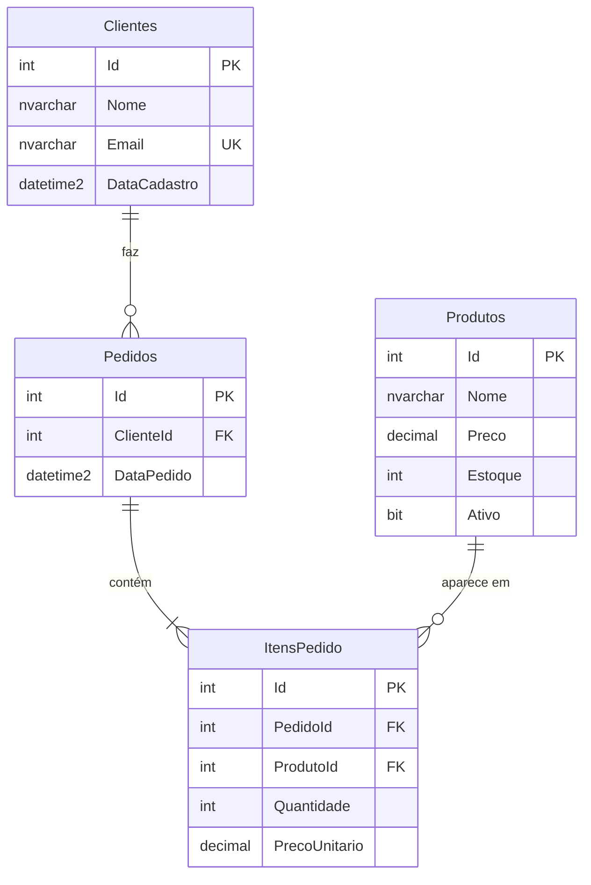

# Especificação: Pedidos de Clientes

| | |
|---|---|
| **Status** | Rascunho, em revisão junto com o plano |
| **Versão** | 0.1 (2026-11-12) |
| **Plano** | [docs/plan.md](plan.md) |

## 1. Objetivo

Permitir que um operador **cadastre pedidos de clientes** (com itens e baixa de estoque) e **consulte os pedidos** com filtros e paginação, além de um **relatório com os 5 clientes que mais compraram** num período.

A solução tem banco SQL Server, API .NET e frontend web, e sobe inteira com `docker compose up`.

## 2. Escopo

**Dentro do escopo**

- Criar pedido com itens, validando cliente, produtos e estoque, e baixando o estoque.
- Listar pedidos com filtro por cliente e período, com paginação.
- Consultar um pedido por id (é o destino do header `Location` do POST).
- Relatório dos 5 clientes de maior valor comprado no período.
- Endpoints de apoio ao frontend: listar clientes e produtos ativos.
- Frontend: listagem com filtros, modal de criação e painel do relatório.
- Scripts SQL de criação e carga, e ambiente Docker completo.

**Fora do escopo (decisão consciente)**

- CRUD de clientes e produtos: os dados vêm do script de carga.
- Autenticação e autorização.
- Editar, cancelar ou excluir pedidos; status de pedido.
- Pagamento, frete, impostos e descontos.
- Múltiplos fusos horários (ver RN-11).

## 3. Modelo de dados



| Tabela | Coluna | Tipo | Restrições |
|---|---|---|---|
| **Clientes** | Id | `INT IDENTITY` | `PK_Clientes` |
| | Nome | `NVARCHAR(150)` | obrigatório; **não é único** (existem homônimos) |
| | Email | `NVARCHAR(254)` | obrigatório, `UX_Clientes_Email` |
| | DataCadastro | `DATETIME2(0)` | obrigatório, padrão `SYSUTCDATETIME()` |
| **Produtos** | Id | `INT IDENTITY` | `PK_Produtos` |
| | Nome | `NVARCHAR(150)` | obrigatório |
| | Preco | `DECIMAL(18,2)` | `CK_Produtos_Preco` (≥ 0) |
| | Estoque | `INT` | `CK_Produtos_Estoque` (≥ 0), última barreira contra estoque negativo |
| | Ativo | `BIT` | padrão 1 |
| **Pedidos** | Id | `INT IDENTITY` | `PK_Pedidos` |
| | ClienteId | `INT` | `FK_Pedidos_Clientes` |
| | DataPedido | `DATETIME2(0)` | obrigatório, em **UTC** |
| **ItensPedido** | Id | `INT IDENTITY` | `PK_ItensPedido` |
| | PedidoId | `INT` | `FK_ItensPedido_Pedidos` (`ON DELETE CASCADE`) |
| | ProdutoId | `INT` | `FK_ItensPedido_Produtos` |
| | Quantidade | `INT` | `CK_ItensPedido_Quantidade` (> 0) |
| | PrecoUnitario | `DECIMAL(18,2)` | `CK_ItensPedido_PrecoUnitario` (≥ 0) |

**Índices** (o SQL Server não cria índice para FK automaticamente):

| Índice | Colunas | Atende |
|---|---|---|
| `IX_Pedidos_ClienteId_DataPedido` | `(ClienteId, DataPedido)` | FK; listagem filtrada por cliente e período |
| `IX_Pedidos_DataPedido` | `(DataPedido) INCLUDE (ClienteId)` | listagem só por período; relatório (range seek coberto) |
| `UX_ItensPedido_PedidoId_ProdutoId` | `UNIQUE (PedidoId, ProdutoId) INCLUDE (Quantidade, PrecoUnitario)` | FK; RN-07 no banco; soma do total por pedido sem lookup |
| `IX_ItensPedido_ProdutoId` | `(ProdutoId)` | FK para Produtos |

O valor total do pedido **não é armazenado**: a fonte da verdade são os itens (`Σ Quantidade × PrecoUnitario`). Isso evita inconsistência entre cabeçalho e itens, e o índice coberto em `ItensPedido` mantém o cálculo barato.

## 4. Regras de negócio

| Id | Regra | Violação |
|---|---|---|
| RN-01 | O pedido deve ter **ao menos 1 item**. | 400 |
| RN-02 | O pedido aceita **no máximo 100 itens** (limite de proteção da API). | 400 |
| RN-03 | O **cliente** informado deve existir. | 422 `CLIENTE_NAO_ENCONTRADO` |
| RN-04 | Todo item referencia um **produto existente**. | 422 `PRODUTO_NAO_ENCONTRADO` |
| RN-05 | O produto deve estar **ativo**. | 422 `PRODUTO_INATIVO` |
| RN-06 | A **quantidade** é um inteiro **maior que zero**. | 400 |
| RN-07 | Um produto **não se repete** no mesmo pedido (para mais unidades, aumente a quantidade). | 400 |
| RN-08 | O **estoque** de cada produto deve ser **≥ quantidade** pedida. | 422 `ESTOQUE_INSUFICIENTE` |
| RN-09 | A criação é **atômica**: pedido, itens e baixa de estoque são gravados numa única transação; qualquer falha desfaz tudo. Com requisições concorrentes o estoque **nunca fica negativo**: a baixa é condicional (`UPDATE ... WHERE Estoque >= @quantidade`) e o `CHECK` do banco é a última barreira. | 422 `ESTOQUE_INSUFICIENTE` |
| RN-10 | O **preço unitário** do item é o preço do produto no momento da criação. O cliente da API **não envia preço**. Valor total = `Σ quantidade × preço unitário`. | — |
| RN-11 | A **data do pedido** é o instante da criação em UTC, definido pelo servidor. Filtros de período recebem **datas** (`yyyy-MM-dd`) em UTC, **inclusivas nas duas pontas**, aplicadas como intervalo semiaberto `[dataInicio 00:00, dataFim + 1 dia 00:00)`. | — |
| RN-12 | Na listagem, os filtros são opcionais; se ambos forem informados, `dataInicio ≤ dataFim`. Filtrar por um cliente inexistente retorna lista vazia (não é erro). | 400 |
| RN-13 | A listagem é ordenada por `DataPedido` desc e depois `Id` desc. Paginação: `pagina ≥ 1` (padrão 1), `tamanhoPagina` entre 1 e 100 (padrão 10). | 400 |
| RN-14 | **Top clientes**: o período é obrigatório. O ranking soma os itens dos pedidos do período **agrupando por cliente (Id, nunca por nome)**, ordena por valor desc com desempate por `ClienteId` asc e retorna até 5. Cliente sem pedido no período não aparece. | 400 |

Ordem de validação: primeiro o **formato** (400: RN-01, 02, 06, 07), depois as **regras que dependem do banco** (422: RN-03, 04, 05, 08). Em 422 a resposta traz um `codigo` estável para o cliente da API tratar.

## 5. API

Base: `http://localhost:8080` (direto) ou `http://localhost:3000/api` (via proxy do frontend). JSON em camelCase. Erros seguem **ProblemDetails (RFC 9457)**, com `traceId`. Erros de regra de negócio trazem também `codigo`. Documentação OpenAPI em `/openapi/v1.json` e Swagger UI em `/swagger`.

### 5.1 `POST /pedidos`

```json
{
  "clienteId": 1,
  "itens": [
    { "produtoId": 3, "quantidade": 2 },
    { "produtoId": 7, "quantidade": 1 }
  ]
}
```

| Status | Quando |
|---|---|
| **201 Created** | Pedido criado. Header `Location: /pedidos/{id}` e corpo = detalhe do pedido (5.2). |
| **400 Bad Request** | JSON inválido ou violação de RN-01, 02, 06 ou 07 (`ValidationProblemDetails` com `errors` por campo, ex.: `itens[1].quantidade`). |
| **422 Unprocessable Entity** | Violação de RN-03, 04, 05 ou 08/09. |

```json
{
  "title": "Regra de negócio violada",
  "status": 422,
  "detail": "Estoque insuficiente para 'Teclado mecânico' (solicitado: 5, disponível: 2).",
  "codigo": "ESTOQUE_INSUFICIENTE",
  "traceId": "00-..."
}
```

### 5.2 `GET /pedidos/{id}`

`200` com o detalhe, ou `404`.

```json
{
  "id": 123,
  "clienteId": 1,
  "clienteNome": "Ana Souza",
  "dataPedido": "2026-11-12T19:04:11Z",
  "valorTotal": 389.80,
  "itens": [
    { "produtoId": 3, "produtoNome": "Teclado mecânico", "quantidade": 2, "precoUnitario": 149.90, "subtotal": 299.80 },
    { "produtoId": 7, "produtoNome": "Mouse sem fio", "quantidade": 1, "precoUnitario": 90.00, "subtotal": 90.00 }
  ]
}
```

### 5.3 `GET /pedidos`

Query string: `clienteId`, `dataInicio`, `dataFim` (todos opcionais), `pagina`, `tamanhoPagina`.

```json
{
  "itens": [
    { "id": 123, "clienteId": 1, "clienteNome": "Ana Souza", "dataPedido": "2026-11-12T19:04:11Z", "quantidadeItens": 2, "valorTotal": 389.80 }
  ],
  "pagina": 1,
  "tamanhoPagina": 10,
  "totalItens": 57,
  "totalPaginas": 6
}
```

`quantidadeItens` é o número de linhas de item do pedido. Página além da última retorna `itens: []` com os totais corretos. Parâmetros inválidos retornam `400`.

### 5.4 `GET /relatorios/top-clientes`

Query string: `dataInicio` e `dataFim` (**obrigatórios**).

```json
[
  { "posicao": 1, "clienteId": 7, "clienteNome": "Carlos Lima", "quantidadePedidos": 12, "valorTotal": 9876.50 }
]
```

Sem datas, ou com `dataInicio > dataFim`, retorna `400`.

### 5.5 Endpoints de apoio

| Endpoint | Retorno |
|---|---|
| `GET /clientes` | `[{ id, nome, email }]` ordenado por nome |
| `GET /produtos` | `[{ id, nome, preco, estoque }]` só produtos ativos, ordenado por nome |
| `GET /health` | `200` quando a API está de pé e o banco responde (usado no healthcheck do Docker) |

## 6. Frontend

**Tela Pedidos**

- Filtros: cliente (lista com opção "Todos"), data inicial e data final. Botões *Filtrar* e *Limpar*.
- Tabela com nº do pedido, cliente, data/hora (no fuso do navegador), quantidade de itens e valor total em R$.
- Paginação com anterior/próxima, indicador "página X de Y" e total de pedidos.
- Estados de carregando, vazio e erro.

**Modal Novo pedido**

- Seleção de cliente.
- Linhas de item com produto (mostrando preço e estoque) e quantidade. Dá para adicionar e remover linhas, e um produto já escolhido não aparece nas outras linhas.
- Total estimado calculado na tela; o valor oficial é o que a API devolve.
- Validação na tela (cliente obrigatório, ao menos 1 item, quantidade ≥ 1). Erros da API (400/422) aparecem no modal com a mensagem do `detail`.
- No sucesso o modal fecha, a listagem é recarregada e aparece a confirmação "Pedido #N criado".

**Painel Top clientes** (extra): período e tabela com o ranking do endpoint 5.4.

## 7. Requisitos não funcionais

| Id | Requisito |
|---|---|
| RNF-01 | `docker compose up` sobe banco (com scripts de criação e carga), API e frontend **sem nenhum passo manual**. A ordem de subida é garantida por healthchecks. |
| RNF-02 | Consultas com predicados *sargable*, paginação no banco (`OFFSET/FETCH`) e índices de suporte (seção 3). |
| RNF-03 | Credenciais via variáveis de ambiente, com padrões de desenvolvimento no compose. A API usa um login com **privilégio mínimo** (leitura e escrita, sem DDL), e o MCP do Claude usa um login **somente leitura**. |
| RNF-04 | Testes unitários (regras e validações), de integração contra **SQL Server real** (Testcontainers, rodando os mesmos scripts de `database/`) e E2E com Playwright. |
| RNF-05 | Pipeline de CI (GitHub Actions) com build e testes a cada push e pull request. |

## 8. Critérios de aceite

| Id | Dado / Quando / Então | Nível de teste |
|---|---|---|
| CA-01 | Dado um cliente e produtos com estoque, quando faço `POST /pedidos` com 2 itens, então recebo `201` com `Location`, o valor total é a soma dos subtotais com o preço atual dos produtos e o estoque de cada produto é reduzido na quantidade pedida. | Unitário + Integração |
| CA-02 | Quando o cliente não existe, recebo `422 CLIENTE_NAO_ENCONTRADO` e nada é gravado. | Unitário + Integração |
| CA-03 | Quando um dos itens não tem estoque suficiente, recebo `422 ESTOQUE_INSUFICIENTE` e **nenhum** estoque é alterado, nem dos outros itens. | Unitário + Integração |
| CA-04 | Quando `itens` está vazio ou ausente, recebo `400`. | Unitário + Integração |
| CA-05 | Quando uma quantidade é ≤ 0, recebo `400` apontando o campo do item. | Unitário |
| CA-06 | Quando o mesmo produto aparece duas vezes, recebo `400`. | Unitário |
| CA-07 | Quando um produto não existe ou está inativo, recebo `422` com `PRODUTO_NAO_ENCONTRADO` ou `PRODUTO_INATIVO`. | Unitário + Integração |
| CA-08 | Dado um produto com estoque K, quando disparo N > K pedidos simultâneos de 1 unidade, então exatamente K são criados e o estoque termina em 0, nunca negativo. | Integração |
| CA-09 | Quando listo sem filtros, recebo a página 1 com 10 pedidos, ordenados do mais recente para o mais antigo, e os totais de paginação corretos. | Integração |
| CA-10 | Quando filtro por `clienteId`, recebo apenas pedidos desse cliente. | Integração |
| CA-11 | Quando filtro por período, recebo apenas pedidos dentro dele, **inclusive os do último dia às 23:59:59**. | Integração |
| CA-12 | Quando `dataInicio > dataFim`, `pagina < 1` ou `tamanhoPagina` fora de 1–100, recebo `400`. | Unitário + Integração |
| CA-13 | Quando peço o top clientes de um período, recebo até 5 clientes em ordem decrescente de valor; pedidos fora do período são ignorados e **clientes homônimos aparecem separados**. | Integração |
| CA-14 | Quando peço o top clientes sem período, recebo `400`. | Integração |
| CA-15 | Pelo frontend, quando crio um pedido no modal, ele aparece no topo da listagem. | E2E |
| CA-16 | Em uma máquina só com Docker, `docker compose up` deixa o frontend acessível em `http://localhost:3000` com dados de exemplo. | Manual + CI |

## 9. Premissas e questões em aberto

- **Fuso horário**: datas são gravadas e filtradas em UTC. Para uma operação real num único fuso (ex.: `America/Sao_Paulo`), o próximo passo seria converter os limites do período a partir do fuso de negócio. Isso foi registrado como limitação conhecida.
- **Volume de clientes e produtos**: os endpoints de apoio devolvem a lista completa, o que é adequado ao volume da demo. Com milhares de registros, o frontend passaria a usar busca paginada (autocomplete).
- **Relatório e a query da Parte 4**: o endpoint de top clientes e a query corrigida da Parte 4 seguem os mesmos princípios (agrupamento por Id, intervalo semiaberto, índice de cobertura). A análise está no README.
